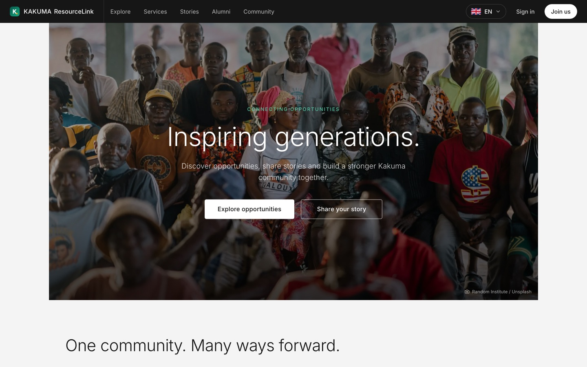
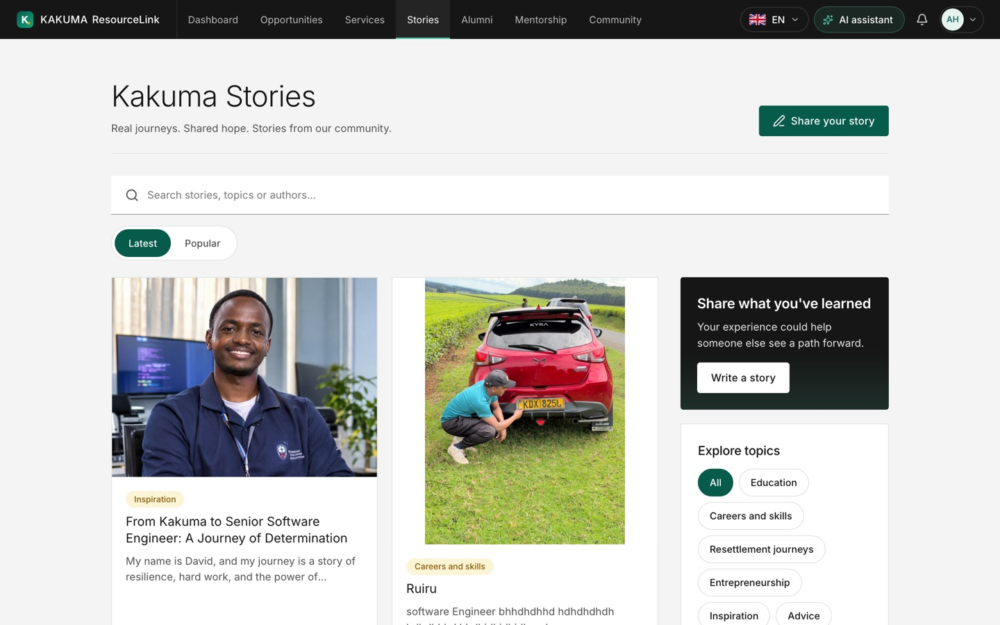
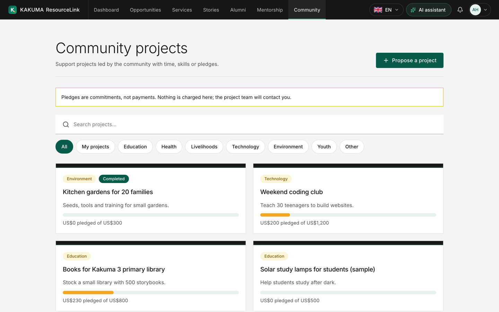
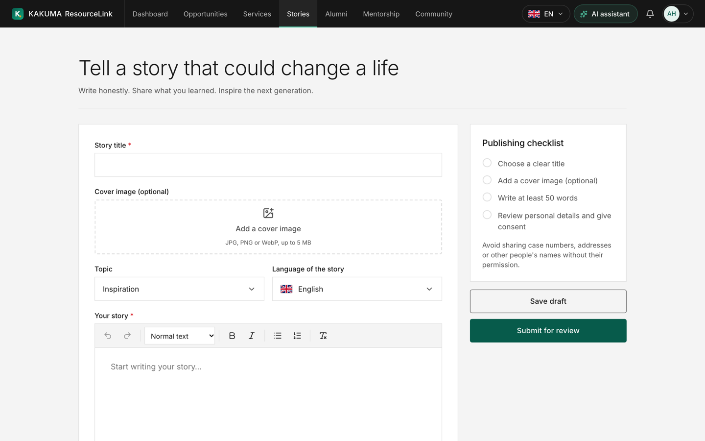
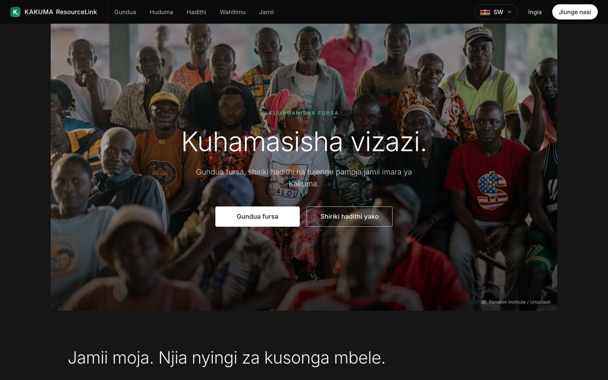
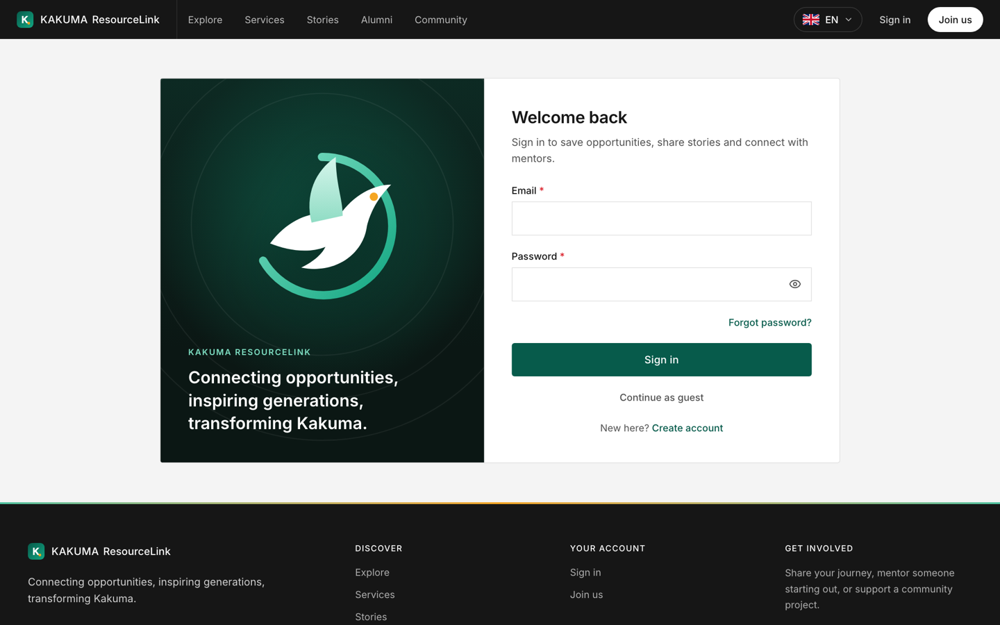
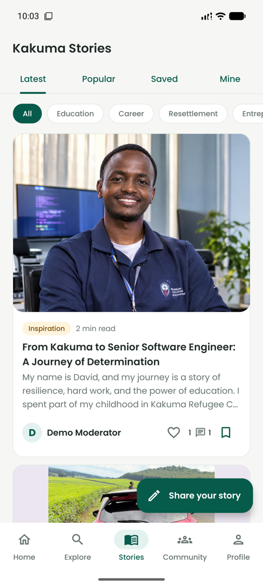
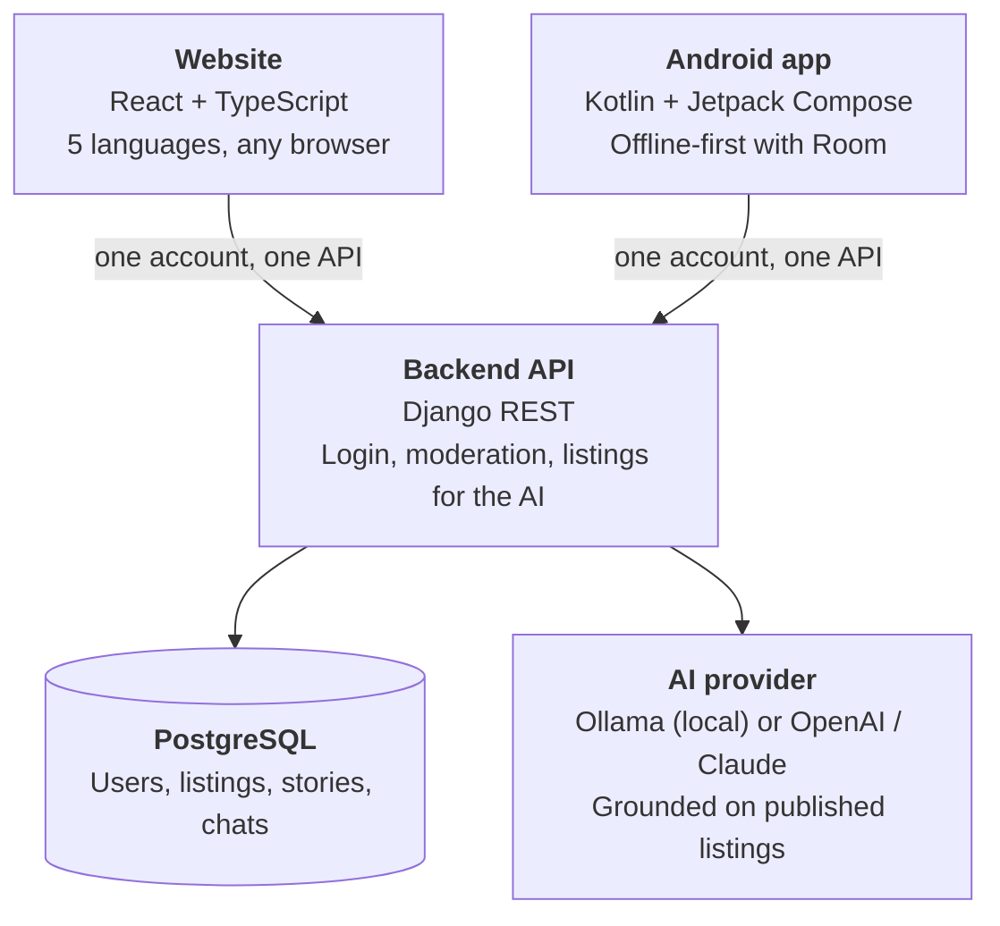

<div align="center">


# Kakuma ResourceLink

**Connecting opportunities, inspiring generations, transforming Kakuma.**

One platform for opportunities, services, stories, alumni mentorship and community projects,<br>
in **5 languages**, on the **web** and in an **offline-first Android app**, with **one account**.

[**▶ Pitch slides**](https://claude.ai/artifact/SreioSxkyP9CdeBQNBWm1d) · [Demo script](docs/DEMO_SCRIPT.md) · [Architecture](docs/architecture/ARCHITECTURE.md) · [API](docs/api/API_CONTRACT.md) · [Security](docs/SECURITY.md)




</div>

## The problem

In Kakuma, information is scattered across notice boards, WhatsApp groups and word of mouth. Alumni abroad want to help but have no channel to reach people. Many people read in a second language, on weak connections.

## Our solution

| | |
|---|---|
| 🎓 **Opportunities** | Scholarships, jobs, training and internships, with filters, bookmarks and deadlines |
| 🏥 **Services** | Health, legal, education and other services in one directory |
| 📖 **Stories** | People share their journeys. Every story is reviewed before it goes public |
| 🤝 **Alumni mentorship** | Former residents around the world mentor people in Kakuma |
| 🌱 **Community projects** | Pledge time, skills or support. A pledge is a commitment, not a payment |
| 🤖 **AI assistant** | Explains listings in plain words, using only what is published on the platform |

### What makes it different

- **AI that stays grounded.** The assistant answers only from listings published on the platform, retrieved for each question. It never invents listings and never decides eligibility or refugee status. It can run fully on our own server through Ollama, so chats never leave it.
- **Built for weak connections.** The Android app saves opportunities and stories for offline reading, shows an offline banner, queues bookmarks until it reconnects, and saves story drafts automatically.
- **Truly multilingual.** English, Kiswahili, Español, Italiano and Deutsch in both apps, and on the server too: emails, error messages and notifications arrive in each person's own language.
- **Safe by design.** Moderation before publishing, kind rejection reasons only the author sees, consent-based alumni profiles that can be hidden, privacy tips against sharing case numbers, and an audit log of moderator actions.

## Screenshots

### Web

<table>
  <tr>
    <td width="50%"><br><sub><b>Find opportunities</b>: search, categories and filters</sub></td>
    <td width="50%"><br><sub><b>Opportunity details</b>: save it, apply, or explain it with AI</sub></td>
  </tr>
  <tr>
    <td><br><sub><b>AI assistant</b>: answers only from published listings</sub></td>
    <td><br><sub><b>Kakuma stories</b>: journeys shared by the community</sub></td>
  </tr>
  <tr>
    <td><br><sub><b>Alumni network</b>: find a mentor anywhere in the world</sub></td>
    <td><br><sub><b>Community projects</b>: pledges are commitments, not payments</sub></td>
  </tr>
  <tr>
    <td><br><sub><b>Write a story</b>: drafts save automatically, with a privacy tip</sub></td>
    <td><br><sub><b>Moderation</b>: every story is reviewed before it goes public</sub></td>
  </tr>
  <tr>
    <td><br><sub><b>Kiswahili and dark mode</b>: the whole site switches</sub></td>
    <td><br><sub><b>Sign in</b>: one account for web and Android</sub></td>
  </tr>
</table>

### Android

<table>
  <tr>
    <td align="center"><br><sub><b>Home</b></sub></td>
    <td align="center"><br><sub><b>Explore</b></sub></td>
    <td align="center"><br><sub><b>Opportunity</b></sub></td>
  </tr>
  <tr>
    <td align="center"><br><sub><b>Stories</b></sub></td>
    <td align="center"><br><sub><b>Alumni network</b></sub></td>
    <td></td>
  </tr>
</table>

## How it fits together



Both clients share one backend, one database and one sign-in (JWT with rotating refresh tokens). No Firebase. AI keys never leave the server.

| Part | Stack | Folder |
|---|---|---|
| Backend API | Django 5.2 · Django REST Framework · PostgreSQL 16 · Simple JWT | [`backend/`](backend/) |
| Android app | Kotlin · Jetpack Compose · MVVM + Clean Architecture · Hilt · Room · Retrofit · Paging | [`mobile/`](mobile/) ([guide](mobile/README.md)) |
| Web app | React 19 · TypeScript · Vite · TanStack Query · Tailwind · i18next | [`frontend/`](frontend/) ([guide](frontend/README.md)) |

## Run it locally

Requirements: Python 3.11+, Docker, Node 20+, and Android Studio for the app.

```bash
# 1. Backend + database
cd backend
cp .env.example .env              # set DJANGO_SECRET_KEY, and an AI provider (see below)
docker compose up -d db           # PostgreSQL 16 on localhost:5432
python3.11 -m venv .venv && source .venv/bin/activate
pip install -r requirements-dev.txt
python manage.py migrate
python manage.py seed_testdata    # fictional test data + test accounts
python manage.py runserver 0.0.0.0:8000

# 2. Website (new terminal)
cd frontend && npm install && npm run dev        # http://localhost:5173

# 3. Android (emulator running)
adb reverse tcp:8000 tcp:8000
cd mobile && ./gradlew :app:installDebug
```

Or run the backend and a production web build together in Docker: `docker compose --profile full up --build` (API on :8000, website on http://localhost:8080).

- API: `http://localhost:8000/api/v1/` · Swagger UI: `http://localhost:8000/api/v1/docs/` · Admin: `http://localhost:8000/admin/`
- **Test accounts** (local only, password `Admin@123`, printed by `seed_testdata`):

  | Role | Account |
  |---|---|
  | Member (main demo persona) | `amina@demo.kakuma.test` |
  | Alumni mentor | `daniel@demo.kakuma.test` |
  | Moderator | `moderator@demo.kakuma.test` |
  | Admin (also Django `/admin/`) | `admin@kakuma.test` |
  | Member who uses Kiswahili | `halima.abdi@kakuma.test` |

  The data covers every state: stories in review, draft and needing changes, mentorship requests in all five states, projects awaiting approval, pledges, and closed or rolling deadlines. The command is safe to re-run and refuses to run when `DEBUG` is off.

### AI assistant

`POST /api/v1/ai/chat/` supports `chat`, `explain_opportunity`, `summarize_story` and `translate`. Pick a provider in `backend/.env`:

| Provider | Settings | Notes |
|---|---|---|
| **Ollama** (local, no key) | `AI_PROVIDER=ollama`, `AI_MODEL=gemma3:12b` | `brew install ollama && ollama pull gemma3:12b`. Nothing leaves the server; handles Kiswahili well |
| OpenAI (default) | `AI_PROVIDER=openai`, `OPENAI_API_KEY` | Conversations are stored only in our database (`store=False`) |
| Claude | `AI_PROVIDER=anthropic`, `ANTHROPIC_API_KEY`, `AI_MODEL` | Server-side refusal fallback with `AI_ENABLE_FALLBACKS` |

Without a working provider the endpoint returns `503 ai_unavailable`; it never makes up an answer. Restart `runserver` after editing `.env`.

### Email and password reset

People who forget their password get a 6-digit code by email (valid 15 minutes, 5 tries, one new code a minute) on both web and Android. Set `EMAIL_BACKEND`, `EMAIL_HOST_USER` and `EMAIL_HOST_PASSWORD` in `backend/.env` (for Gmail, use an app password). Without them, emails print to the `runserver` console.

## Tests

| Part | Command | Tests |
|---|---|---|
| Backend | `cd backend && pytest` | 126 (PostgreSQL; the AI provider is always mocked) |
| Android | `cd mobile && ./gradlew testDebugUnitTest` (+ `connectedDebugAndroidTest`) | 80 unit + 6 instrumented |
| Web | `cd frontend && npm test` | 53 |

## Documentation

- [Pitch slides](https://claude.ai/artifact/SreioSxkyP9CdeBQNBWm1d) and [demo script](docs/DEMO_SCRIPT.md)
- [Architecture, ERD and roadmap](docs/architecture/ARCHITECTURE.md)
- [API contract](docs/api/API_CONTRACT.md) · [OpenAPI schema](docs/api/openapi.yaml)
- [Design system and screen inventory](docs/designs/DESIGN_SYSTEM.md)
- [Security review](docs/SECURITY.md)
- Server translations (sw/es/it/de): see [`backend/locale/`](backend/locale/); after changing a string run `makemessages`, translate, then `compilemessages` and commit both `.po` and `.mo`

## What's next

- **Partner-verified listings**, checked with organisations working in Kakuma
- **SMS access** for people with basic phones
- **A real hosted deployment** so anyone in Kakuma can sign up

## Team

| Name | GitHub |
|---|---|
| Simon Muriithi | [@Fleur41](https://github.com/Fleur41) |
| Halkano Malise | [@malise5](https://github.com/malise5) |

## Content policy

All seed data is **fictional sample content** for testing and demos: organisations are generic and people are invented. Replace it with listings verified with partner organisations before a real launch.
