<div align="center">


# Kakuma ResourceLink

**Connecting opportunities, inspiring generations, transforming Kakuma.**

One platform for opportunities, services, stories, alumni mentorship and community projects,<br>
in **5 languages**, on the **web** and in an **offline-first Android app**, with **one account**.

<a href="https://kakuma-resource-link.vercel.app"></a>
<a href="https://github.com/Fleur41/Kakuma-ResourceLink/releases/latest/download/Kakuma-ResourceLink.apk"></a>

[**Try it live**](#try-it-live) · [**▶ Video walkthrough**](#video-walkthrough) · [**▶ Pitch slides**](https://claude.ai/artifact/SreioSxkyP9CdeBQNBWm1d) · [Demo script](docs/DEMO_SCRIPT.md) · [Architecture](docs/architecture/ARCHITECTURE.md) · [API](docs/api/API_CONTRACT.md) · [Security](docs/SECURITY.md)


</div>

## Try it live

| | Link | Notes |
|---|---|---|
| 🌐 **Web app** | [kakuma-resource-link.vercel.app](https://kakuma-resource-link.vercel.app) | Works in any modern browser, on desktop and mobile |
| 📱 **Android app** | [Download the APK](https://github.com/Fleur41/Kakuma-ResourceLink/releases/latest/download/Kakuma-ResourceLink.apk) (v1.0.0, 3.7 MB) | Android 8.0 or newer · [all releases](https://github.com/Fleur41/Kakuma-ResourceLink/releases) |
| ⚙️ **API** | [kakuma-resourcelink-api.onrender.com/api/v1](https://kakuma-resourcelink-api.onrender.com/api/v1/opportunities/) | Interactive docs: [Swagger UI](https://kakuma-resourcelink-api.onrender.com/api/v1/docs/) · Status: [health check](https://kakuma-resourcelink-api.onrender.com/health/) |

The web app and the Android app share the same live backend, so **one account works on both**. Browsing opportunities, services, stories and the alumni network needs no account. Sign-in details for the demo accounts are shared with judges alongside our submission.

> [!NOTE]
> The demo runs on free hosting. After about 15 minutes without visitors the API goes to sleep, so the **first request can take up to a minute**. Opening the [health check](https://kakuma-resourcelink-api.onrender.com/health/) wakes it up.

<details>
<summary><b>Installing the Android app</b></summary>
<br>

1. On your Android phone, open the [APK download link](https://github.com/Fleur41/Kakuma-ResourceLink/releases/latest/download/Kakuma-ResourceLink.apk).
2. Open the downloaded file. If Android asks, allow your browser or file manager to **install unknown apps**.
3. Tap **Install**, then open **Kakuma ResourceLink**.

The APK is a demo build signed for direct installation; it is not distributed through Google Play yet. Saved opportunities and stories stay readable offline once they have been opened.

</details>

## Video walkthrough

A 3-minute tour of the website, the Android app and the backend. Pick the version you prefer: both show the same thing.

<table>
  <tr>
    <td width="50%"><a href="docs/videos/walkthrough-narrated.mp4"></a><br><sub><b>▶ <a href="docs/videos/walkthrough-narrated.mp4">With narration</a></b>: a voice explains each step</sub></td>
    <td width="50%"><a href="docs/videos/walkthrough-silent.mp4">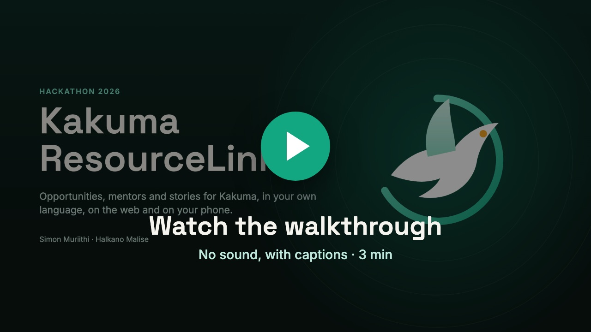</a><br><sub><b>▶ <a href="docs/videos/walkthrough-silent.mp4">Without sound</a></b>: on-screen captions explain each step</sub></td>
  </tr>
</table>

<details>
<summary><b>What the video covers</b></summary>

| Time | Part | What you see |
|---|---|---|
| 0:00 | Pitch | The problem in Kakuma and the solution |
| 0:32 | **Website** | Browsing as a guest |
| 0:40 | | Amina filters and searches opportunities |
| 0:49 | | Explain with AI answers from published listings, with sources |
| 1:01 | | Stories, with automatic drafts and a privacy tip |
| 1:09 | | The alumni network and mentors |
| 1:17 | | Community projects and pledges |
| 1:25 | | A moderator reviews a story |
| 1:33 | | The whole site in Kiswahili |
| 1:41 | **Android app** | The same account on the phone |
| 1:48 | | Search and category filters |
| 1:54 | | Opportunity details |
| 2:01 | | Airplane mode: saved content still opens |
| 2:08 | | Stories and the alumni network |
| 2:19 | | The AI assistant on the phone |
| 2:27 | **Backend** | Architecture: Django REST, PostgreSQL, local AI with Ollama |
| 2:37 | | The documented API and its security |
| 2:47 | Close | Tests, what's next, and thanks |

</details>

## Pitch deck

<a href="https://claude.ai/artifact/SreioSxkyP9CdeBQNBWm1d">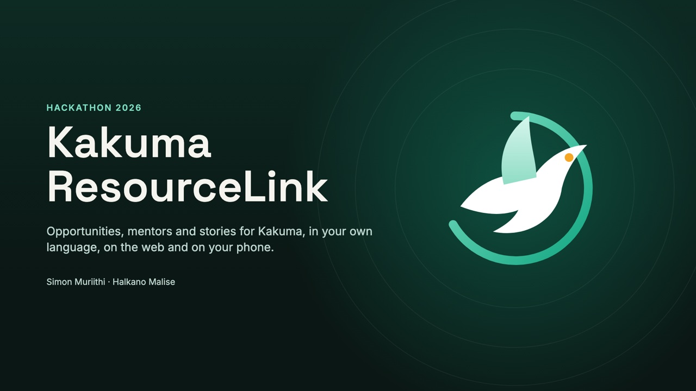</a>

**[▶ Open the full pitch deck](https://claude.ai/artifact/SreioSxkyP9CdeBQNBWm1d)**: present it in the browser, or download it as PowerPoint or PDF. The whole pitch is below, slide by slide.

<details open>
<summary><b>All slides</b></summary>
<br>

<table>
  <tr>
    <td width="50%"><a href="https://claude.ai/artifact/SreioSxkyP9CdeBQNBWm1d">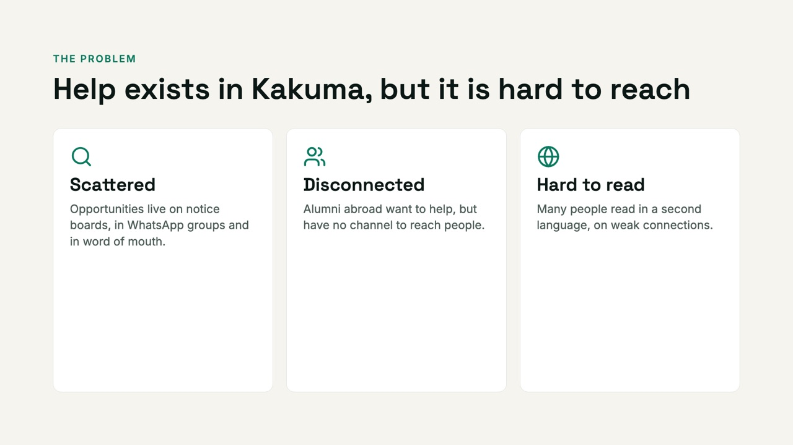</a><br><sub><b>2.</b> The problem</sub></td>
    <td width="50%"><a href="https://claude.ai/artifact/SreioSxkyP9CdeBQNBWm1d">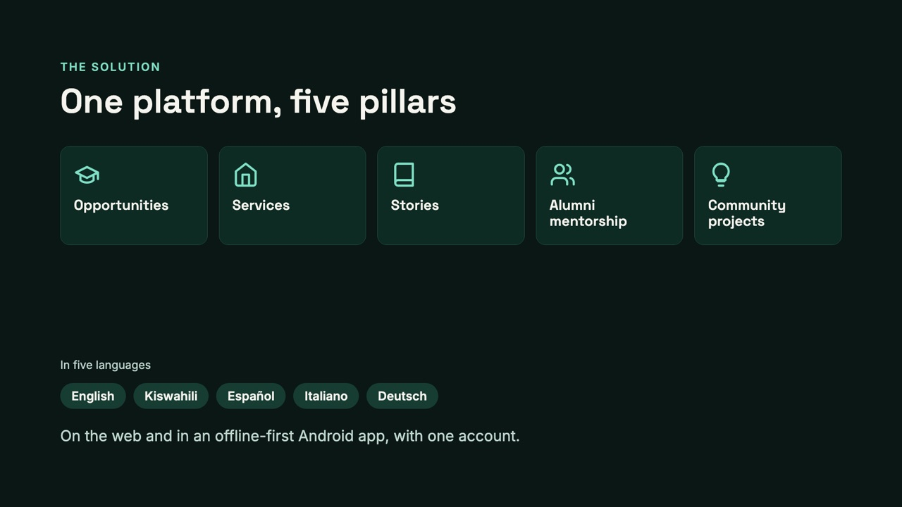</a><br><sub><b>3.</b> One platform, five pillars</sub></td>
  </tr>
  <tr>
    <td width="50%"><a href="https://claude.ai/artifact/SreioSxkyP9CdeBQNBWm1d">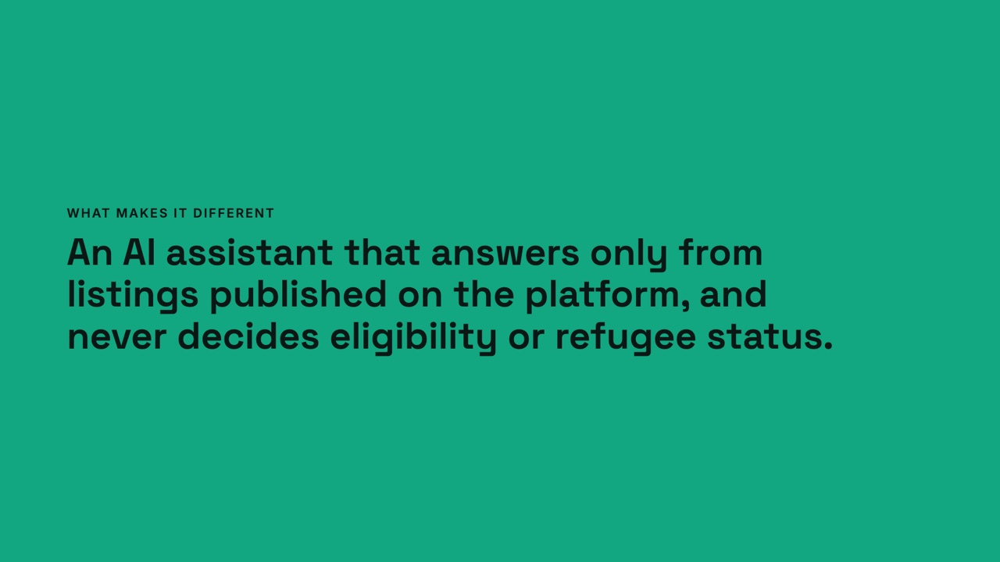</a><br><sub><b>4.</b> What makes it different</sub></td>
    <td width="50%"><a href="https://claude.ai/artifact/SreioSxkyP9CdeBQNBWm1d">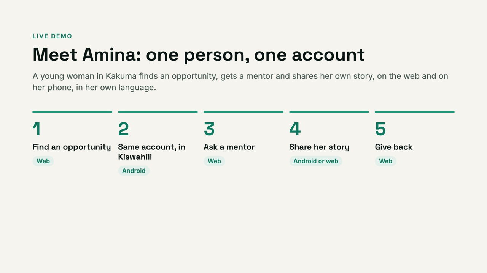</a><br><sub><b>5.</b> The demo: Amina’s journey</sub></td>
  </tr>
  <tr>
    <td width="50%"><a href="https://claude.ai/artifact/SreioSxkyP9CdeBQNBWm1d">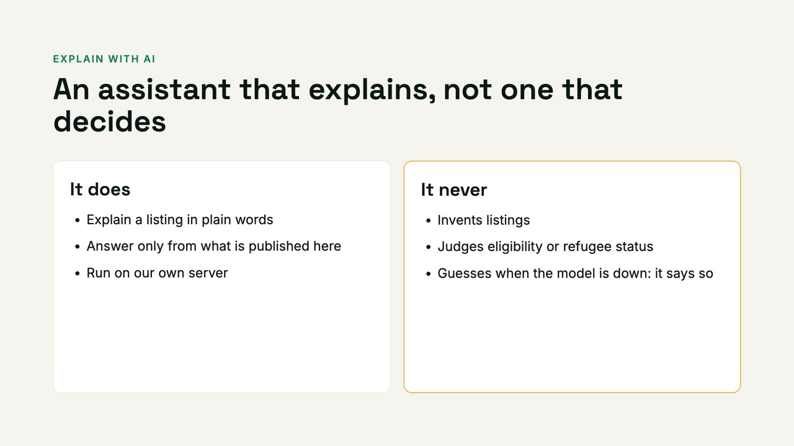</a><br><sub><b>6.</b> An AI that explains, never decides</sub></td>
    <td width="50%"><a href="https://claude.ai/artifact/SreioSxkyP9CdeBQNBWm1d">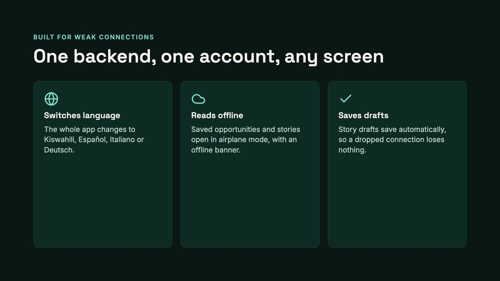</a><br><sub><b>7.</b> Built for weak connections</sub></td>
  </tr>
  <tr>
    <td width="50%"><a href="https://claude.ai/artifact/SreioSxkyP9CdeBQNBWm1d">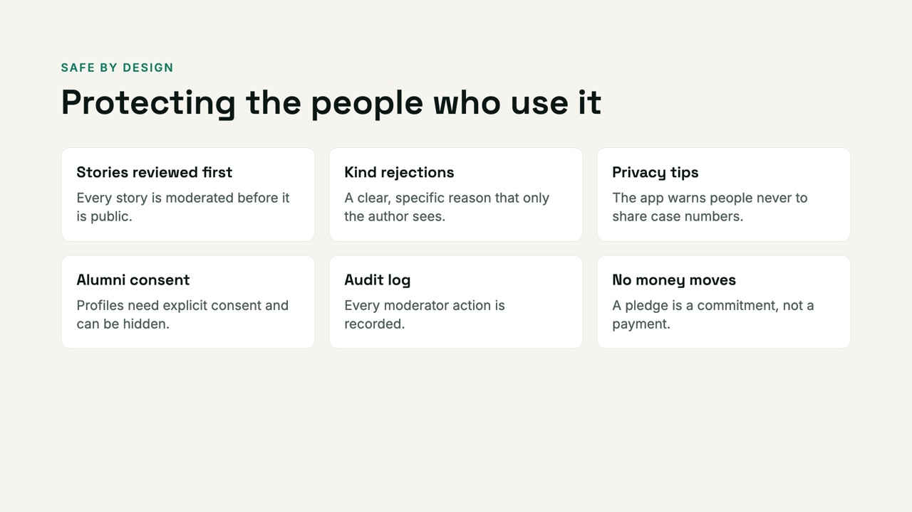</a><br><sub><b>8.</b> Safe by design</sub></td>
    <td width="50%"><a href="https://claude.ai/artifact/SreioSxkyP9CdeBQNBWm1d">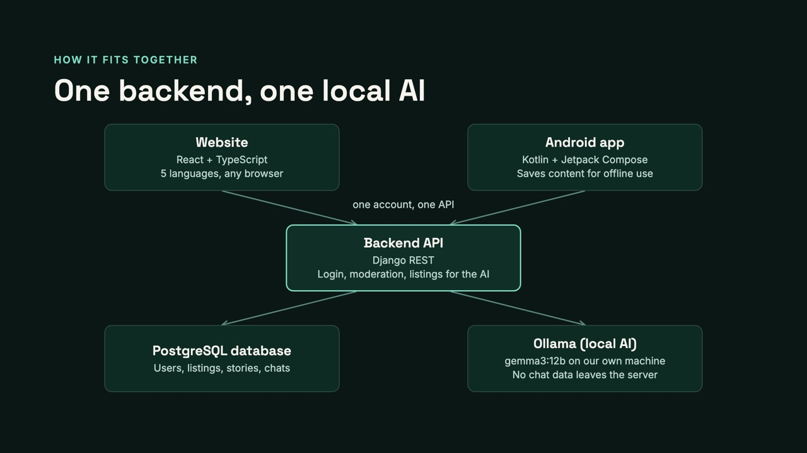</a><br><sub><b>9.</b> How it fits together</sub></td>
  </tr>
  <tr>
    <td width="50%"><a href="https://claude.ai/artifact/SreioSxkyP9CdeBQNBWm1d">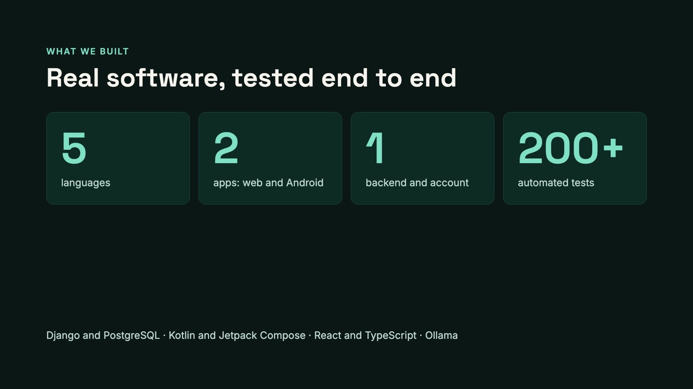</a><br><sub><b>10.</b> What we built</sub></td>
    <td width="50%"><a href="https://claude.ai/artifact/SreioSxkyP9CdeBQNBWm1d">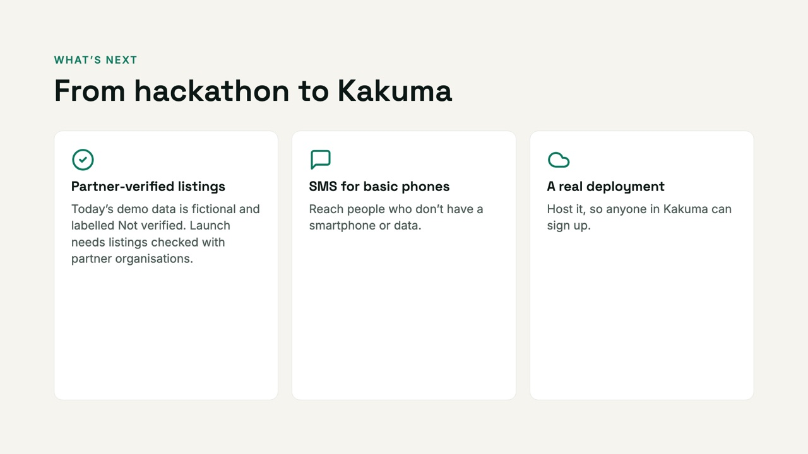</a><br><sub><b>11.</b> What’s next</sub></td>
  </tr>
  <tr>
    <td width="50%"><a href="https://claude.ai/artifact/SreioSxkyP9CdeBQNBWm1d">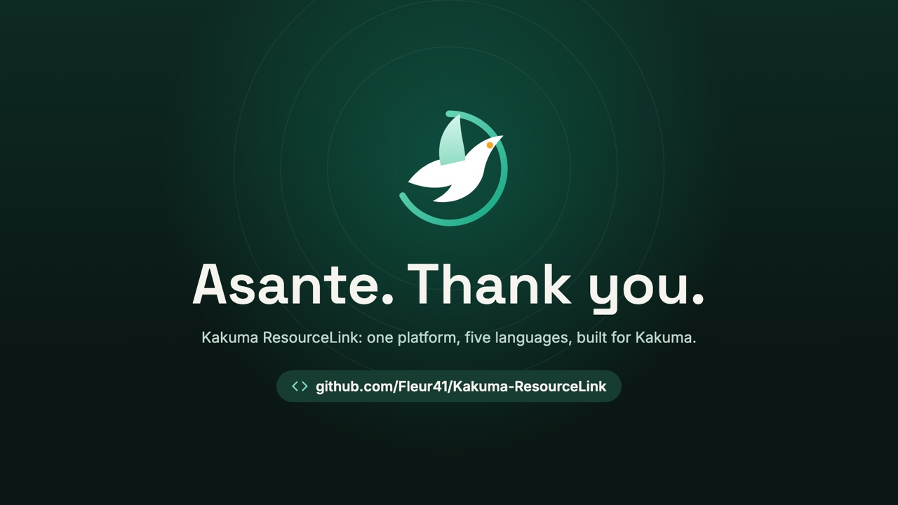</a><br><sub><b>12.</b> Thank you</sub></td>
    <td width="50%"><a href="https://claude.ai/artifact/SreioSxkyP9CdeBQNBWm1d">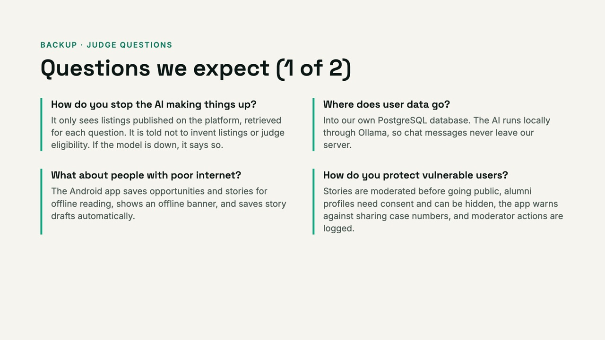</a><br><sub><b>13.</b> Judge questions (1 of 2)</sub></td>
  </tr>
</table>

</details>

## The problem

In Kakuma, information is scattered across notice boards, WhatsApp groups and word of mouth. Alumni abroad want to help but have no channel to reach people. Many people read in a second language, on weak connections.

## Our solution

| | |
|---|---|
| 🎓 **Opportunities** | Scholarships, jobs, training and internships, with filters, bookmarks and deadlines |
| 🏥 **Services** | Health, legal, education and other services in one directory |
| 📖 **Stories** | People share their journeys. Every story is reviewed before it goes public |
| 🤝 **Alumni mentorship** | Former residents around the world mentor people in Kakuma |
| 🌱 **Community projects** | Pledge time, skills or support. A pledge is a commitment, not a payment |
| 🤖 **AI assistant** | Explains listings in plain words, using only what is published on the platform |

### What makes it different

- **AI that stays grounded.** The assistant answers only from listings published on the platform, retrieved for each question. It never invents listings and never decides eligibility or refugee status. It can run fully on our own server through Ollama, so chats never leave it.
- **Built for weak connections.** The Android app saves opportunities and stories for offline reading, shows an offline banner, queues bookmarks until it reconnects, and saves story drafts automatically.
- **Truly multilingual.** English, Kiswahili, Español, Italiano and Deutsch in both apps, and on the server too: emails, error messages and notifications arrive in each person's own language.
- **Safe by design.** Moderation before publishing, kind rejection reasons only the author sees, consent-based alumni profiles that can be hidden, privacy tips against sharing case numbers, and an audit log of moderator actions.

## Screenshots

### Web

<table>
  <tr>
    <td width="50%">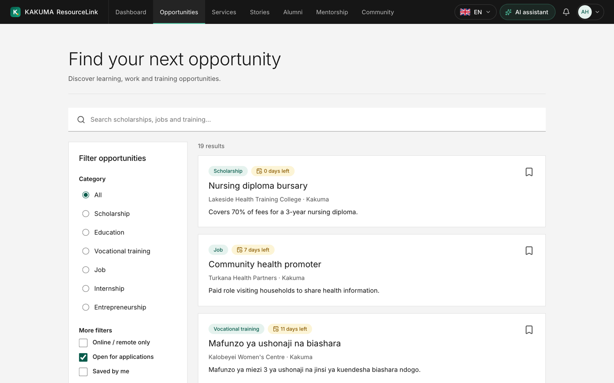<br><sub><b>Find opportunities</b>: search, categories and filters</sub></td>
    <td width="50%">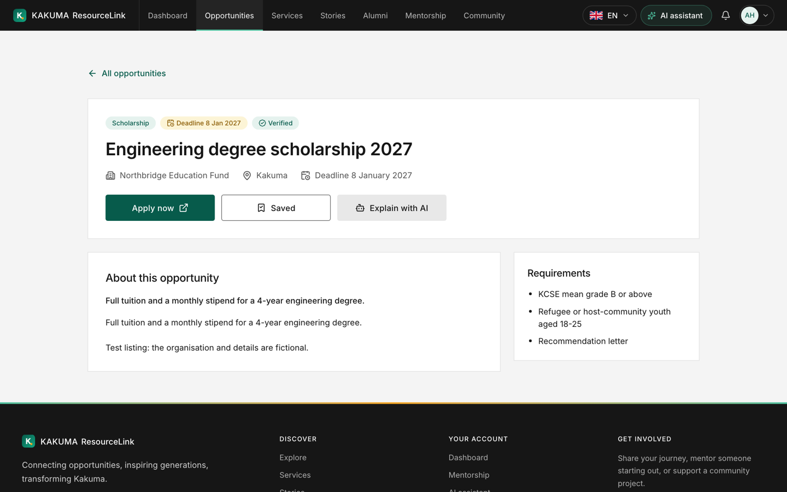<br><sub><b>Opportunity details</b>: save it, apply, or explain it with AI</sub></td>
  </tr>
  <tr>
    <td>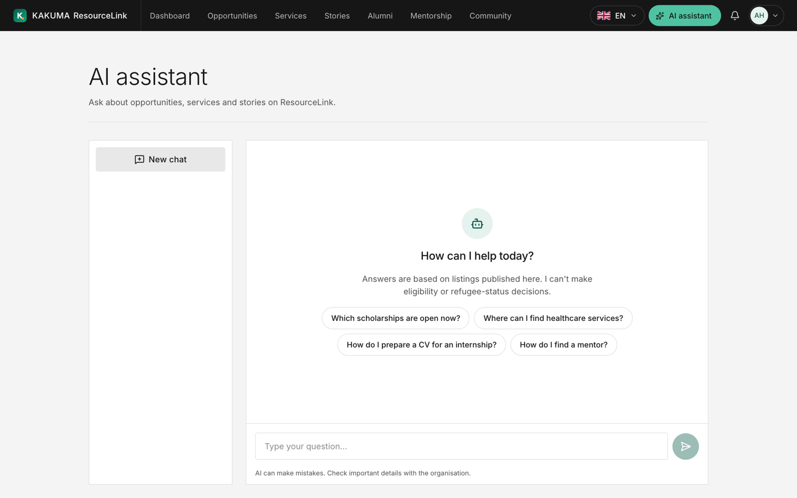<br><sub><b>AI assistant</b>: answers only from published listings</sub></td>
    <td><br><sub><b>Kakuma stories</b>: journeys shared by the community</sub></td>
  </tr>
  <tr>
    <td>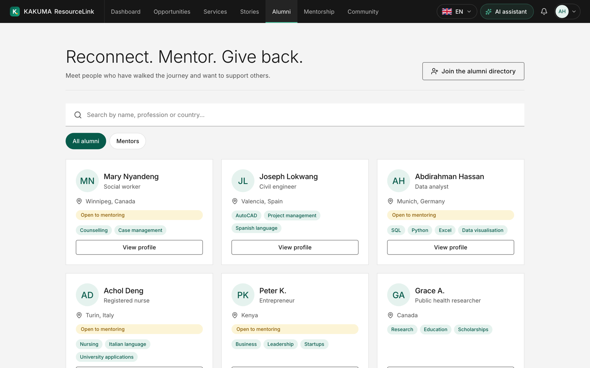<br><sub><b>Alumni network</b>: find a mentor anywhere in the world</sub></td>
    <td><br><sub><b>Community projects</b>: pledges are commitments, not payments</sub></td>
  </tr>
  <tr>
    <td><br><sub><b>Write a story</b>: drafts save automatically, with a privacy tip</sub></td>
    <td>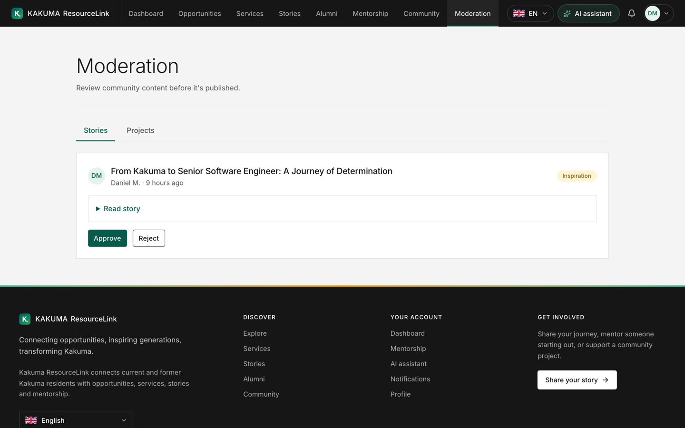<br><sub><b>Moderation</b>: every story is reviewed before it goes public</sub></td>
  </tr>
  <tr>
    <td><br><sub><b>Kiswahili and dark mode</b>: the whole site switches</sub></td>
    <td><br><sub><b>Sign in</b>: one account for web and Android</sub></td>
  </tr>
</table>

### Android

<table>
  <tr>
    <td align="center">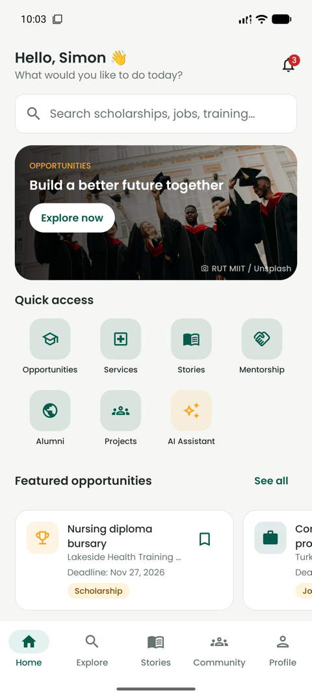<br><sub><b>Home</b></sub></td>
    <td align="center">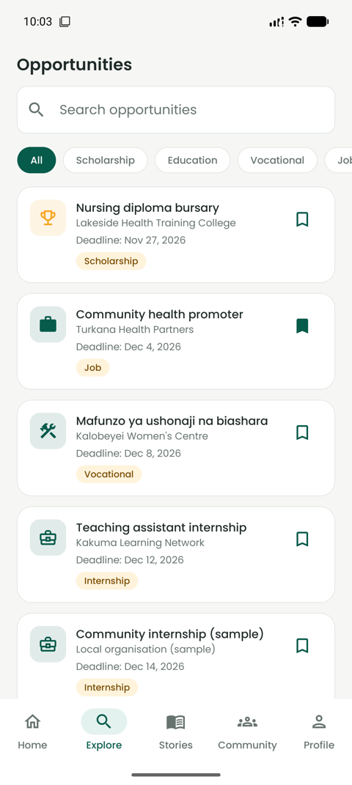<br><sub><b>Explore</b></sub></td>
    <td align="center">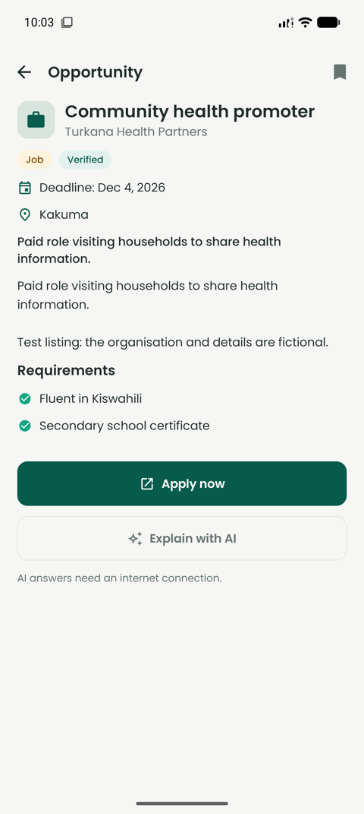<br><sub><b>Opportunity</b></sub></td>
  </tr>
  <tr>
    <td align="center"><br><sub><b>Stories</b></sub></td>
    <td align="center">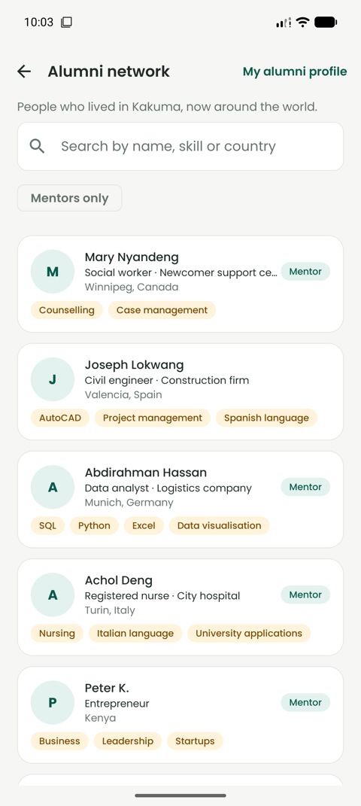<br><sub><b>Alumni network</b></sub></td>
    <td align="center">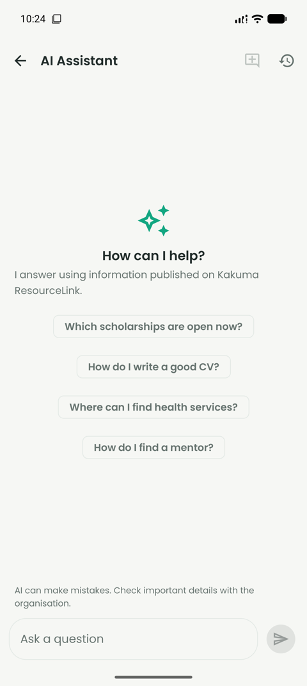<br><sub><b>AI assistant</b></sub></td>
  </tr>
</table>

## How it fits together

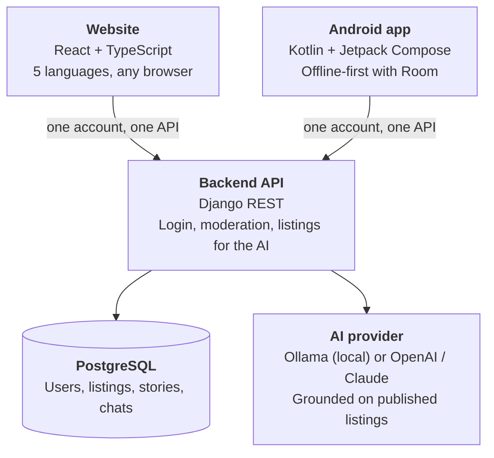

Both clients share one backend, one database and one sign-in (JWT with rotating refresh tokens). No Firebase. AI keys never leave the server.

| Part | Stack | Folder |
|---|---|---|
| Backend API | Django 5.2 · Django REST Framework · PostgreSQL 16 · Simple JWT | [`backend/`](backend/) |
| Android app | Kotlin · Jetpack Compose · MVVM + Clean Architecture · Hilt · Room · Retrofit · Paging | [`mobile/`](mobile/) ([guide](mobile/README.md)) |
| Web app | React 19 · TypeScript · Vite · TanStack Query · Tailwind · i18next | [`frontend/`](frontend/) ([guide](frontend/README.md)) |

## Run it locally

Requirements: Python 3.11+, Docker, Node 22+, and Android Studio for the app.

```bash
# 1. Backend + database
cd backend
cp .env.example .env              # set DJANGO_SECRET_KEY, and an AI provider (see below)
docker compose up -d db           # PostgreSQL 16 on localhost:5432
python3.11 -m venv .venv && source .venv/bin/activate
pip install -r requirements-dev.txt
python manage.py migrate
python manage.py seed_testdata    # fictional test data + test accounts
python manage.py runserver 0.0.0.0:8000

# 2. Website (new terminal)
cd frontend && npm install && npm run dev        # http://localhost:5173

# 3. Android (emulator running)
adb reverse tcp:8000 tcp:8000
cd mobile && ./gradlew :app:installDebug
```

Or run the backend and a production web build together in Docker: `docker compose --profile full up --build` (API on :8000, website on http://localhost:8080).

- API: `http://localhost:8000/api/v1/` · Swagger UI: `http://localhost:8000/api/v1/docs/` · Admin: `http://localhost:8000/admin/`
- **Test accounts** (local only, password `Admin@123`, printed by `seed_testdata`):

  | Role | Account |
  |---|---|
  | Member (main demo persona) | `amina@demo.kakuma.test` |
  | Alumni mentor | `daniel@demo.kakuma.test` |
  | Moderator | `moderator@demo.kakuma.test` |
  | Admin (also Django `/admin/`) | `admin@kakuma.test` |
  | Member who uses Kiswahili | `halima.abdi@kakuma.test` |

  The data covers every state: stories in review, draft and needing changes, mentorship requests in all five states, projects awaiting approval, pledges, and closed or rolling deadlines. The command is safe to re-run and refuses to run when `DEBUG` is off.

### AI assistant

`POST /api/v1/ai/chat/` supports `chat`, `explain_opportunity`, `summarize_story` and `translate`. Pick a provider in `backend/.env`:

| Provider | Settings | Notes |
|---|---|---|
| **Ollama** (local, no key) | `AI_PROVIDER=ollama`, `AI_MODEL=gemma3:12b` | `brew install ollama && ollama pull gemma3:12b`. Nothing leaves the server; handles Kiswahili well |
| OpenAI (default) | `AI_PROVIDER=openai`, `OPENAI_API_KEY` | Conversations are stored only in our database (`store=False`) |
| Claude | `AI_PROVIDER=anthropic`, `ANTHROPIC_API_KEY`, `AI_MODEL` | Server-side refusal fallback with `AI_ENABLE_FALLBACKS` |
| Google Gemini or any OpenAI-compatible API | `AI_PROVIDER=compatible`, `AI_BASE_URL`, `AI_API_KEY`, `AI_MODEL` | Free tier, used by the live demo. Gemini: `AI_BASE_URL=https://generativelanguage.googleapis.com/v1beta/openai/`, `AI_MODEL=gemini-2.5-flash` |

Without a working provider the endpoint returns `503 ai_unavailable`; it never makes up an answer. Restart `runserver` after editing `.env`.

### Email and password reset

People who forget their password get a 6-digit code by email (valid 15 minutes, 5 tries, one new code a minute) on both web and Android. Set `EMAIL_BACKEND`, `EMAIL_HOST_USER` and `EMAIL_HOST_PASSWORD` in `backend/.env` (for Gmail, use an app password). Without them, emails print to the `runserver` console.

## Deployment

The live demo runs entirely on free tiers:

| Part | Host | Config |
|---|---|---|
| Backend API | [Render](https://render.com) web service (Python, Frankfurt) | [`render.yaml`](render.yaml) Blueprint |
| Database | Render PostgreSQL | Created by the same Blueprint |
| Uploaded images | [Supabase Storage](https://supabase.com/docs/guides/storage) (S3-compatible, public bucket) | `AWS_*` variables on Render |
| Web app | [Vercel](https://vercel.com) | [`frontend/vercel.json`](frontend/vercel.json) |
| Android app | APK on [GitHub Releases](https://github.com/Fleur41/Kakuma-ResourceLink/releases) | Release builds call the Render API |

<details>
<summary><b>Deploy your own copy</b></summary>
<br>

1. **Backend.** In Render, choose **New → Blueprint** and pick this repository. Render creates the API and the database from `render.yaml`, generates the Django secret key, and asks for the remaining secrets: the AI provider and key, and the storage bucket. Migrations run automatically on every start.
2. **Images.** Create a public bucket (for example `media` in Supabase Storage) and an S3 access key, then set `AWS_STORAGE_BUCKET_NAME`, `AWS_S3_ENDPOINT_URL`, `AWS_S3_REGION_NAME`, `AWS_S3_CUSTOM_DOMAIN`, `AWS_ACCESS_KEY_ID` and `AWS_SECRET_ACCESS_KEY`. Any S3-compatible service works (Cloudflare R2, Backblaze B2, AWS S3).
3. **Demo data (optional).** From your machine, using the database's external URL:
   ```bash
   cd backend
   DATABASE_URL='<external database URL>' DJANGO_SETTINGS_MODULE=config.settings.development \
     python manage.py seed_testdata --password '<a strong password>'
   ```
4. **Website.** In Vercel, import the repository with **Root Directory** set to `frontend` and add `VITE_API_URL=https://<your-api>.onrender.com/api/v1` before the first build.
5. **Connect them.** On Render, set `CORS_ALLOWED_ORIGINS` and `CSRF_TRUSTED_ORIGINS` to the Vercel address (no trailing slash).
6. **Android.** Set the release API address with `-Pkakuma.apiUrl=https://<your-api>.onrender.com/api/v1/` (or change the default in `mobile/app/build.gradle.kts`) and run `./gradlew assembleRelease`.

On Render's free plan outgoing email is blocked, so password-reset codes appear in the service logs instead of being emailed. A paid plan removes that limit and the cold starts.

</details>

## Tests

| Part | Command | Tests |
|---|---|---|
| Backend | `cd backend && pytest` | 129 (PostgreSQL; the AI provider is always mocked) |
| Android | `cd mobile && ./gradlew testDebugUnitTest` (+ `connectedDebugAndroidTest`) | 80 unit + 6 instrumented |
| Web | `cd frontend && npm test` | 53 |

## Documentation

- [Pitch slides](https://claude.ai/artifact/SreioSxkyP9CdeBQNBWm1d) and [demo script](docs/DEMO_SCRIPT.md)
- [Architecture, ERD and roadmap](docs/architecture/ARCHITECTURE.md)
- [API contract](docs/api/API_CONTRACT.md) · [OpenAPI schema](docs/api/openapi.yaml)
- [Design system and screen inventory](docs/designs/DESIGN_SYSTEM.md)
- [Security review](docs/SECURITY.md)
- Server translations (sw/es/it/de): see [`backend/locale/`](backend/locale/); after changing a string run `makemessages`, translate, then `compilemessages` and commit both `.po` and `.mo`

## What's next

- **Partner-verified listings**, checked with organisations working in Kakuma
- **SMS access** for people with basic phones
- **Production hosting**: always-on servers, our own domain, and the Android app on Google Play

## Team

| Name | Role | GitHub |
|---|---|---|
| Simon Muriithi | Lead developer: backend API and database, Android app, web app, AI assistant, translations, tests and docs | [@Fleur41](https://github.com/Fleur41) |
| Halkano Malise | Frontend and visual design, research, user testing and the pitch | [@malise5](https://github.com/malise5) |

## Content policy

All seed data is **fictional sample content** for testing and demos: organisations are generic and people are invented. Replace it with listings verified with partner organisations before a real launch.
